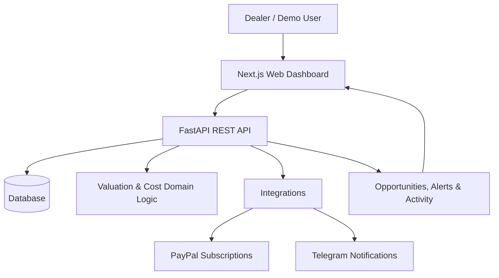

# ChronoArb

**See the opportunity. Understand the numbers. Make smarter watch acquisitions.**

ChronoArb is a watch-dealer acquisition-intelligence dashboard built to help dealers evaluate potential luxury-watch acquisitions in one place. It brings watch listings, valuation context, acquisition costs, opportunity signals, alerts, and decision history into a unified workspace.

The central question ChronoArb helps a dealer investigate is:

> **Should I acquire this watch at this price?**

Instead of relying on a listing price alone, users can review estimated values and cost components, inspect the available opportunity context, and record what they decide to do next.

> **Prototype notice:** This repository contains a hackathon/demo build. The hosted demo is populated with seeded demonstration data. Estimates are informational only and do not verify a watch's authenticity, guarantee listing availability, or promise a resale price or profit.

---

## What ChronoArb does

Luxury-watch dealers may need to review listings from different sources and consider more than the advertised price before making an acquisition decision. Fees, shipping, taxes, condition uncertainty, and a realistic resale estimate can all affect the economics of a deal.

ChronoArb is designed to make that review more structured:

1. Browse watch listings and potential acquisition opportunities.
2. Review the valuation context and estimated acquisition/resale economics.
3. Compare the cost components that contribute to the estimate.
4. Configure alerts and review activity.
5. Record a decision and, where applicable, capture the eventual trade outcome.

ChronoArb is an intelligence and decision-support tool. It is not a watch marketplace, payment escrow service, automated purchasing bot, or watch-authentication service.

## Key features

### Opportunities dashboard

Browse a centralized feed of potential acquisition opportunities. The feed surfaces decision-support information such as opportunity status, score, estimated profit/ROI fields, and when an opportunity was published.

### Opportunity details and valuation context

Open an opportunity to inspect its valuation information, confidence context, comparable-count information, and available version/history details. Financial estimates are intended to be traceable to explicit inputs rather than presented as guaranteed outcomes.

### Watchlists

Create and manage watchlists to organize watch references and items of interest.

### Alerts

Create, edit, enable, disable, and remove alert rules. Review delivery history and request test notifications for supported channels.

### Activity and trade outcomes

Review team activity and recorded decisions. Opportunity decisions include actions such as **Contacted**, **Dismissed**, and **Purchased**. Trade-outcome records can capture acquisition/resale details for later review.

### Organization settings and integrations

Manage organization-level preferences and configure supported integrations. The prototype includes integration surfaces for Telegram notifications and subscription billing.

### Billing

ChronoArb includes a PayPal Subscriptions integration. Subscription checkout and lifecycle handling depend on valid server-side PayPal Sandbox or live credentials and a configured plan mapping. The hackathon setup should use Sandbox credentials and a Sandbox buyer account.

### Admin console

The admin area provides operational views for source configuration, feature flags, audit events, unmatched listings, and duplicate groups.

## How it works

At a high level, ChronoArb separates the user interface, API, and domain logic:



The backend exposes API modules for identity, catalog, listings, opportunities, feedback, alerts, organization settings, integrations, billing, and operations. Shared domain logic contains financial value objects and cost calculations; the source-adapter package keeps source-specific parsing concerns separate from core business logic.

## Technology

| Layer | Technologies |
|---|---|
| Web application | Next.js 16, React 19, TypeScript |
| UI | Material UI, Tailwind CSS |
| Server state | TanStack Query |
| API | Python 3.13+, FastAPI, Pydantic |
| Persistence | SQLAlchemy 2, Alembic; SQLite for the documented local demo setup and PostgreSQL for the Render deployment |
| Domain logic | Python domain package, Decimal-based financial arithmetic |
| Workspace | pnpm workspaces, Turborepo |
| Integrations | PayPal Subscriptions, Telegram Bot API |
| Deployment | Render |

## Repository structure

```text
.
├── apps/
│   ├── web/                 # Next.js frontend
│   ├── api/                 # FastAPI application and API tests
│   └── worker/              # Background worker package
├── packages/
│   ├── api-client-ts/       # Shared TypeScript API client
│   ├── design-tokens/       # Shared design tokens
│   ├── domain-python/       # Core business and financial logic
│   └── source-adapters/     # Source-specific adapter package
├── alembic/                 # Database migration scripts
├── docs/
│   ├── api/                 # OpenAPI contract and APIMatic workflow notes
│   ├── deployment/          # Deployment instructions
│   └── architecture/        # Architecture documentation
├── render.yaml              # Render Blueprint
├── package.json             # Workspace scripts
├── pnpm-workspace.yaml
└── pyproject.toml           # Python tooling configuration
```

## Try the demo

The hackathon deployment is configured for reviewer access:

1. Open the deployed ChronoArb web application.
2. Navigate to **Opportunities**.
3. Browse the seeded demo opportunities and open an item to inspect its details.
4. Explore **Watches**, **Alerts**, **Activity**, **Settings**, and the **Admin** area.

No application login is required in the current hackathon demo configuration.

**Demo access is intentionally simplified.** The deployment uses a seeded demo organization and disables authentication for judge access. This mode is only for a controlled demonstration and must not be used for a public production deployment.

If the Render free services have been idle, allow approximately 30–60 seconds for them to wake up on the first request.

## Run locally

### Prerequisites

- Git
- Node.js 22 or newer
- pnpm 11.3.0 (Corepack can activate the pinned version)
- Python 3.13 or newer
- Windows PowerShell commands are shown below; adapt activation commands for your shell if needed.

### 1. Clone the repository

```powershell
git clone https://github.com/palakv07/Watch-Arbitrage-A.git
cd Watch-Arbitrage-A
```

### 2. Install the web workspace dependencies

```powershell
corepack enable
corepack prepare pnpm@11.3.0 --activate
pnpm install
```

### 3. Configure the local environment

Copy the example environment file to the repository root:

```powershell
Copy-Item .env.example .env
```

The example configuration is intended for local development. It uses a local SQLite database and sets the demo authentication mode. Review every variable before changing the configuration. Do not commit your real `.env` file or share secrets.

### 4. Set up and start the API

From the repository root:

```powershell
py -3.13 -m venv .venv
.\.venv\Scripts\Activate.ps1
python -m pip install --upgrade pip
python -m pip install -e .\packages\domain-python
python -m pip install -e ".\apps\api[dev]"
```

Initialize and seed the local database, then start FastAPI:

```powershell
Set-Location .\apps\api
python -m apps.api.init_local_db
python -m apps.api.seed
python -m uvicorn apps.api.main:app --reload
```

The API is available at:

- API base: `http://127.0.0.1:8000`
- Interactive API docs: `http://127.0.0.1:8000/docs`
- Health check: `http://127.0.0.1:8000/health`

### 5. Start the web application

Open a **second terminal** at the repository root:

```powershell
pnpm --filter @chronoarb/web dev
```

Then visit:

- Web application: [http://localhost:3000/opportunities](http://localhost:3000/opportunities)

If port 3000 is already in use, Next.js may select another available port and print the URL in the terminal.

### Useful workspace commands

Run these from the repository root:

```powershell
pnpm dev
pnpm build
pnpm lint
pnpm typecheck
pnpm test
```

The root scripts use Turborepo to run the corresponding task across configured workspace packages. The web app also has a Playwright end-to-end test script:

```powershell
pnpm --filter @chronoarb/web test:e2e
```

## Configuration and integrations

All application configuration is supplied through environment variables. Start with [`.env.example`](.env.example), which documents the available settings. The most relevant integration variables are listed below.

### PayPal Subscriptions

The backend uses PayPal's server-side REST API for subscription operations and webhook verification. Configure these values on the **API service only**:

| Variable | Purpose |
|---|---|
| `CHRONOARB_PAYPAL_CLIENT_ID` | PayPal application client ID |
| `CHRONOARB_PAYPAL_CLIENT_SECRET` | Server-side PayPal client secret |
| `CHRONOARB_PAYPAL_WEBHOOK_ID` | Webhook ID used for signature verification |
| `CHRONOARB_PAYPAL_PLAN_IDS` | JSON mapping from ChronoArb plan keys to PayPal plan IDs |
| `CHRONOARB_PAYPAL_API_BASE_URL` | PayPal API base URL; use the Sandbox endpoint for testing |
| `CHRONOARB_PAYPAL_RETURN_URL` | Checkout return URL |
| `CHRONOARB_PAYPAL_CANCEL_URL` | Checkout cancellation URL |

For the hackathon Sandbox configuration, the application plan key is `pro_monthly`. It can be mapped to the PayPal Sandbox plan configured for the project. Use a PayPal developer Sandbox buyer account to approve a test subscription; Sandbox checkout does not charge real money.

Never put merchant secrets, webhook credentials, access tokens, or other private credentials in this README, frontend code, screenshots, or public issue reports.

### Telegram notifications

Telegram alert delivery requires a bot and destination chat. Configure these variables on the API/notification service:

| Variable | Purpose |
|---|---|
| `CHRONOARB_TELEGRAM_BOT_TOKEN` | Bot token issued by Telegram's BotFather |
| `CHRONOARB_TELEGRAM_BOT_USERNAME` | Bot username used by the account-linking flow |
| `CHRONOARB_TELEGRAM_CHAT_ID` | Numeric chat ID or channel username |
| `CHRONOARB_WEB_BASE_URL` | Public web URL used in notification links |

The notification dispatcher is separate from the API process. See [the API setup guide](apps/api/README.md#telegram-alerts) for commands to run the dispatcher and send a test message.

## API documentation

- Interactive local API documentation: `http://127.0.0.1:8000/docs`
- OpenAPI contract: [`docs/api/openapi.yaml`](docs/api/openapi.yaml)
- APIMatic CLI workflow notes: [`docs/api/APIMATIC.md`](docs/api/APIMATIC.md)

The repository documents an optional APIMatic CLI workflow for OpenAPI documentation and SDK generation. That workflow is separate from the APIMatic Context Plugin; the Context Plugin was not used for this integration.

## Deployment

The repository includes a Render Blueprint at [`render.yaml`](render.yaml). It provisions:

- A Python web service for the FastAPI backend
- A Node web service for the Next.js frontend
- A PostgreSQL database for hosted demo data

For step-by-step instructions, environment variable configuration, URL updates, and troubleshooting, see the [Render deployment guide](docs/deployment/render.md).

The hosted hackathon blueprint intentionally sets authentication to disabled so judges can access the seeded demo without creating an account. **Do not use this setting in production.** A production deployment must enable and correctly configure authentication, authorization, secrets management, database access controls, and operational safeguards.

## Important disclosures

### Valuation and financial estimates

ChronoArb's current valuation and cost calculations are deterministic and use explicit financial inputs with decimal arithmetic. Estimates are informational decision-support outputs. They are not investment, financial, or purchasing advice and do not guarantee:

- the authenticity or condition of a watch;
- that a listing is still available or that a seller will complete a transaction;
- an executable resale price;
- a positive margin, return, or profit.

Users should independently verify listings, sellers, watch condition, authenticity, fees, taxes, and resale assumptions before making a purchase decision.

### AI disclosure

The current application does **not** call an external AI model or AI service at runtime. GitHub Copilot in VS Code was used as a development assistant for coding and troubleshooting; it is not an AI service integrated into the running product. This build should therefore not be described as having a runtime AI integration.

### Demo data and authentication

The hackathon deployment uses seeded demonstration data and intentionally disabled authentication for reviewer access. It is not a production-ready security configuration and should not be used with real dealer, customer, or payment data.

### Integrations and availability

PayPal checkout/webhooks and Telegram delivery are available only when the required credentials, plan mapping, webhook configuration, and notification process have been configured. Their presence in the codebase does not mean every deployment has those credentials enabled.

## Contributing

Contributions, bug reports, and suggestions are welcome.

1. Fork the repository.
2. Create a feature branch.
3. Make focused changes and add or update tests where appropriate.
4. Run the relevant lint, type-check, and test commands.
5. Open a pull request with a clear description of the change.

Please do not include API keys, credentials, private customer data, or real payment information in commits or issue reports.
